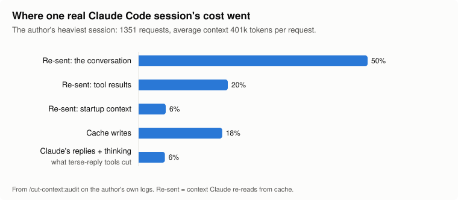
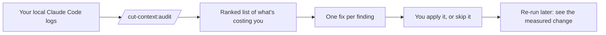
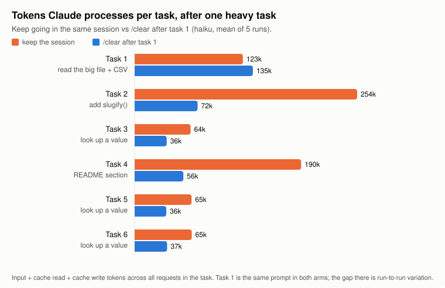
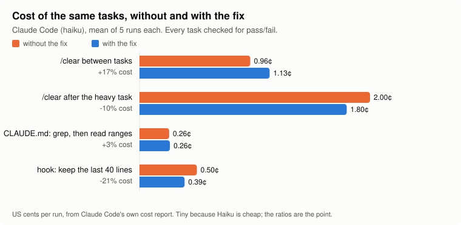

# cut-context

**Find out what your Claude Code tokens are actually spent on, and cut the part that's waste.**

[](https://www.agensi.io/skills/cut-context)

A free, read-only plugin for [Claude Code](https://claude.com/claude-code). Run one
command and it reads your own session logs and tells you, in plain numbers, where
your usage goes and which single change would save the most.

```
/cut-context:audit
```

---

## The problem in one picture

Every time Claude Code makes a request, it sends **the whole conversation so far**:
every message, every file it read, every command output. Claude's reply is a small
part of the cost. Re-reading everything that came before is most of it.



| Where the cost went (one real session, 1,351 requests) | Share |
|---|---:|
| Re-sending the conversation | 50% |
| Re-sending tool results (files, command output, screenshots) | 20% |
| Cache writes | 18% |
| Re-sending the startup context (system prompt, CLAUDE.md, tools) | 6% |
| **Claude's replies + thinking** | **6%** |

Many popular "save tokens" tools make Claude's replies shorter. In this session
that's the 6%. **cut-context goes after the other 94%.**

---

## What it does



1. **Measures** every request in your logs, weighted by what it really costs.
2. **Ranks the leaks**: context that keeps growing, big tool results that stay in
   context for hundreds of requests, cache misses, an oversized `CLAUDE.md`, heavy
   subagent use.
3. **Names one fix per leak.** Nothing changes unless you say so.
4. **Re-runs show what changed**, measured per request so a quieter week doesn't
   count as a "saving".
5. **If nothing is worth fixing, it says so.**

### What a report looks like

```
VERDICT: biggest leak is 42% of your cost: context above 200k tokens on 74% of requests (avg 401k, max 966k).

WHERE THE COST GOES (≈$151.15, from Claude Code's own cost records)
  context re-read from cache    76%
  cache writes                  18%
  Claude's output + thinking     6%

FINDINGS AND FIXES
  1. [42%] Context above 200k tokens on 74% of requests
     fix: /clear between unrelated tasks (it is free), or /compact earlier...
  2. [13%] 16 cache misses re-wrote the whole context
  3. [11%] Browser tool results (screenshots, page dumps) stay in context
  4. [4%]  Whole-file reads stay in context
```

---

## Does fixing what it finds actually save anything?

We measured it rather than claiming it. The same tasks ran **with and without** a
fix the audit recommends, five times each, on a fresh copy of a test project, with
every task checked for pass/fail. Costs come from Claude Code's own usage report.

### The fix that matters most: `/clear` after a heavy task

Claude read a 2,700-line file and a CSV, then did five small, unrelated tasks.
Without `/clear`, every later task drags that file along. With `/clear` after
task 1, each small task starts light.



**The five follow-up tasks cost 43% less** (0.87¢ → 0.49¢ per run), and all 30
tasks still passed in both arms. The bigger the context you carry, the bigger the
saving. The real session above averaged 401k tokens of context per request; the
test project only reached about 66k.

### Not every fix helps, which is why you measure first



| Fix | Change in cost | What we learned |
|---|---:|---|
| `/clear` after a heavy task | **−10%** per run (−43% on the follow-ups) | Worth it once the context is big. |
| A hook that trims test output to the last 40 lines | **−21%** | Worth it for noisy test suites. |
| `/clear` between every small task | **+17%** | **Costs more.** Each fresh session rebuilds its startup context. Only clear when the context is big, which is what the audit tells you. |
| A `CLAUDE.md` rule: "grep first, read line ranges" | **+3%** (no real change) | Claude already did this on its own. |

All 180 checked tasks passed, with and without the fixes. Full numbers are in
[`bench/RESULTS.md`](bench/RESULTS.md), and the harness is in [`bench/`](bench/) so
you can re-run it.

> **Fine print.** These runs used Claude Haiku (cheap, so the cents are tiny; the
> ratios are the point) on a small test project, five runs per arm. Your results
> depend on your sessions. That's the reason the audit measures *your* logs instead
> of promising a percentage.

---

## Install

In Claude Code:

```
/plugin marketplace add Paulie-Aditya/cut-context
/plugin install cut-context@cut-context
```

Then, in any project you've used Claude Code in:

```
/cut-context:audit               # this project, last 7 days
/cut-context:audit --days 30     # a longer window
/cut-context:audit --all         # every project
```

**Prefer a plain skill to a plugin?** Install it from
[Agensi](https://www.agensi.io/skills/cut-context) (free), or build it yourself with
`python3 package_skill.py`, unzip `dist/cut-context.zip` into `~/.claude/skills/`, and
run `/cut-context`.

No Claude needed? Run it directly: `python3 plugins/cut-context/skills/audit/audit.py --help`

## What it reads, and what it never does

| It reads | It never |
|---|---|
| Your Claude Code session logs in `~/.claude/projects/` (and their `subagents/` folders) | makes a network call (a test enforces it) |
| The size of your `CLAUDE.md` files | installs hooks |
| | changes your settings, MCP config or `CLAUDE.md` |

It writes one small JSON snapshot per run to `~/.claude/cut-context/audits/`, so the
next run can compare (`--no-save` turns this off). The whole tool is one Python file
using only the standard library: [`audit.py`](plugins/cut-context/skills/audit/audit.py).

## How it counts

- **Weighted cost.** Tokens don't all cost the same. Re-reading cached context costs
  0.1× a normal input token, writing to the cache 1.25× or 2×, and output 5×. The
  audit weights every request accordingly.
- **Carry cost.** A tool result that stays in context is re-sent on every later
  request. Its carry cost is its size times the number of later requests, up to the
  next compaction.
- **Checkable totals.** Token totals come straight from the `usage` fields in your
  logs, the same ones [ccusage](https://github.com/ryoppippi/ccusage) reads.
- **Estimated sizes.** Individual tool-result sizes are estimates (about 4
  characters per token, about 1,600 tokens per screenshot).
- **Dollar figures** appear only when your logs include Claude Code's own cost
  records. On a Pro or Max plan you pay in usage limits rather than dollars; the
  shares still show what uses up your limit.

## Common fixes it points to

| Finding | Fix |
|---|---|
| Context keeps growing past 200k | `/clear` between unrelated tasks (free), or `/compact` earlier |
| Cache misses after breaks | Start fresh after a long idle gap instead of continuing a huge session |
| Browser screenshots stay in context | Run browser checks in a subagent; prefer text snapshots |
| Whole-file reads on big files | Grep first, then read line ranges; on big repos, a code index such as Codebase Memory MCP or Repowise |
| Long command output | Filter it (`tail`, `grep`), or use [RTK](https://github.com/rtk-ai/rtk) for Bash output |
| `CLAUDE.md` over 200 lines | Move workflow sections into skills, which load only when used |
| Heavy subagent use | Give simple subagents a smaller model |

## Develop

```
python3 -m unittest discover tests          # the audit's tests
python3 bench/run.py --reps 5 --model haiku # the benchmark (spends real tokens: the full run cost $0.37)
python3 bench/report.py                     # rebuild bench/RESULTS.md and the charts in docs/
```

MIT licensed. Not affiliated with or endorsed by Anthropic.
